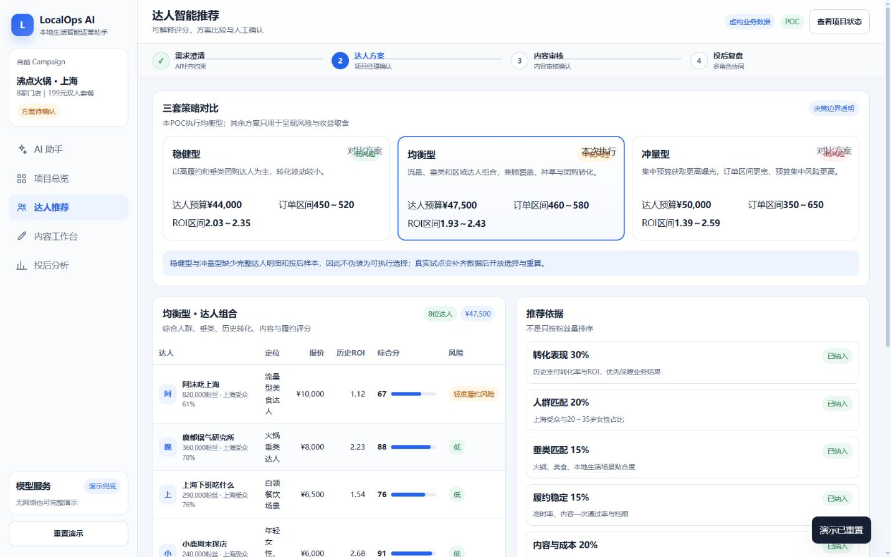
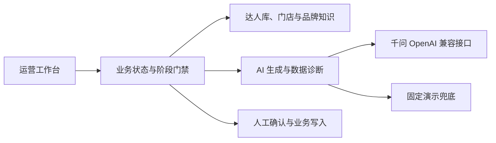

# LocalOps AI｜本地生活智能运营助手 POC

## 文档大纲

- 项目概览
- 核心能力
- 系统架构
- 快速开始
- 项目结构
- 验证与边界

## 项目概览

LocalOps AI 是一个面向本地生活运营团队的 AI 智能运营助手 POC。项目以虚构品牌“沸点火锅”的上海 8 店达人投放 Campaign 为统一上下文，把需求澄清、达人推荐、内容审核、投后诊断和协同任务串成一条可运行、可解释、可复盘的业务闭环。

项目重点不是制作一个只会对话的机器人，而是验证 AI 如何进入真实业务流程：先补齐约束，再生成建议；关键业务动作保留人工确认；数据事实与模型推断明确分层。



项目特点：

- 本地优先：Node.js 18+ 即可运行，无第三方运行依赖。
- 稳定演示：千问不可用或无网络时自动使用固定兜底结果。
- 可解释决策：展示推荐权重、预算校验、风险区间和替换理由。
- 人工控制：方案写入、脚本审核和任务创建均保留人工确认。
- 数据可信：内置 11 项数据一致性检查，所有业务数据均明确标注为虚构样本。
- 响应式体验：支持桌面与移动端，并提供键盘焦点和减少动态效果模式。

## 核心能力

1. **需求澄清**：主动确认 5 万元预算是否包含投流，避免口径错误传递到后续方案。
2. **达人方案**：比较稳健型、均衡型和冲量型策略，展示 8 位达人组合与推荐依据。
3. **内容审核**：生成 45 秒探店脚本，支持编辑、版本锁定和人工审核。
4. **投后复盘**：分析达人、门店和转化漏斗表现，区分事实与待验证推断。
5. **任务闭环**：将诊断结果转换为项目经理、达人运营、内容审核和数据运营的协同任务。

推荐体验路径：

1. 创建达人投放方案。
2. 选择“5 万元全部用于达人合作”。
3. 查看三套策略，完成一次同预算达人替换。
4. 人工确认均衡型方案并生成探店脚本。
5. 审核脚本后推进至投后一周。
6. 载入模拟数据，让 Agent 完成诊断并生成任务看板。

## 系统架构



技术实现：

- 前端：原生 HTML、CSS、JavaScript。
- 服务端：Node.js 原生 HTTP 服务。
- AI：阿里云百炼千问 OpenAI 兼容接口。
- 状态：浏览器 `localStorage`，用于保存单机演示进度。
- 数据：本地 JSON 样本与固定兜底结果。
- 校验：Node.js 数据一致性脚本与 GitHub Actions。

服务端仅监听 `127.0.0.1`。API Key 只从服务端环境变量读取，不进入前端代码、日志示例或截图。

## 快速开始

### 环境要求

- Windows、macOS 或 Linux
- Node.js 18 或更高版本
- npm（随 Node.js 安装）

项目没有第三方运行依赖，无需执行 `npm install`。

### 启动演示

```bash
npm start
```

然后访问：

- 业务 Demo：<http://127.0.0.1:4173/>
- 项目案例页：<http://127.0.0.1:4173/case-study.html>

Windows 用户也可以双击 `启动Demo.bat`。

### 启用千问

不要把真实 API Key 写入代码、提交到 Git，或发送到公开聊天中。

PowerShell：

```powershell
$env:DASHSCOPE_API_KEY="你的Key"
$env:QWEN_MODEL="qwen-plus"
npm start
```

macOS / Linux：

```bash
export DASHSCOPE_API_KEY="你的Key"
export QWEN_MODEL="qwen-plus"
npm start
```

可用环境变量：

| 变量 | 默认值 | 用途 |
|---|---|---|
| `DASHSCOPE_API_KEY` | 空 | 千问 API Key；为空时使用演示兜底 |
| `QWEN_MODEL` | `qwen-plus` | 千问模型名称 |
| `QWEN_BASE_URL` | 百炼兼容接口 | 自定义 OpenAI 兼容地址 |
| `LOCALOPS_DEMO_MODE` | `0` | 设置为 `1` 时强制使用固定兜底 |
| `LOCALOPS_PORT` | `4173` | 本地服务端口 |

强制使用演示兜底：

```powershell
$env:LOCALOPS_DEMO_MODE="1"
npm start
```

### 执行检查

```bash
npm test
```

该命令会检查达人费用、预估订单、门店订单、GMV、ROI，以及核心 JavaScript 文件语法。

## 项目结构

```text
localops-ai-demo/
├─ public/                 # 页面、交互、样式与案例截图
├─ data/                   # Campaign、达人、门店、知识和投后样本
├─ scripts/                # 数据校验与 Windows 启动脚本
├─ .github/workflows/      # GitHub Actions 持续集成
├─ PRODUCT.md              # 产品目标、用户、能力和约束
├─ DESIGN.md               # 设计系统与界面原则
├─ server.mjs              # 静态服务、业务 API、千问调用与兜底
├─ package.json            # 运行、校验和测试命令
└─ LICENSE                 # MIT License
```

## 验证与边界

固定业务口径：

- 上海 8 家虚构门店，199 元双人套餐。
- 达人预算上限 50,000 元，计划合作费 47,500 元，机动预留 2,500 元。
- 目标 500 笔支付订单，目标 GMV 99,500 元，目标 ROI 不低于 2.0。
- 投后模拟结果为 420 单、83,580 元 GMV、支付 ROI 1.76、播放量 125 万。
- 支付归因窗口为发布后 7 日，30 日核销周期尚未结束。

所有品牌、门店、达人和经营数据均为虚构样本，只用于验证产品流程与 Agent 决策方式，不代表真实商业成果。

本项目是业务价值 POC，不是生产系统。真实上线仍需要接入达人平台、交易、门店、合同、权限、审计和内容规则数据，并补充账号体系、数据库、监控和正式安全评估。

GitHub Pages 只能托管静态文件，无法直接运行本项目的 Node.js API。若需要公开在线体验，可部署到支持 Node.js 的平台，或将演示兜底改造成纯静态版本。

本项目采用 [MIT License](LICENSE)。
